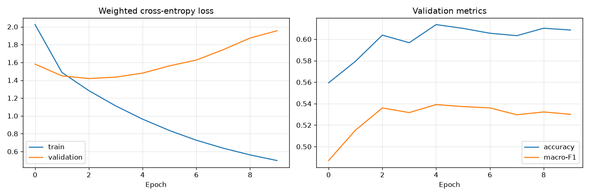

# News Category Classifier: Multi Head Self Attention from Scratch using PyTorch

Classifies 210k news articles into 32 categories using headline and short desc

Multi head self attention layer written myself then tested against PyTorch's MultiheadAttention


## Pipeline
1. **Preprocessing** ([src/dataset.py](src/dataset.py)):
   - Join headline and description
   - Lowercase, tokenise, remove stopwords and lemmatise 
   - Cap each text at 40 tokens and add `<EOS>` and `<PAD>` tokens
   - Words seen fewer than 3 times become `<UNK>`
2. **Embeddings** ([src/glove.py](src/glove.py)): The embedding layer is initialised from GloVe vectors and is fine-tuned during training.
3. **Model** ([src/model.py](src/model.py)): Embedding → multi-head self-attention → flatten → dropout → linear → sigmoid → dropout → linear
4. **Training** ([src/train.py](src/train.py)): Adam algorithm used

## Verifying attention implementation
[src/compare_attention.py](src/compare_attention.py) copies hand written layer's Q/K/V weights into `torch.nn.MultiheadAttention` to checks the outputs and per-head attention maps agree, with and without the padding mask:

```
Without padding mask:   max |diff| output 1.19e-07, attention 5.96e-08
With padding mask:      max |diff| output 1.19e-07, attention 5.96e-08
```

## Results
### Full dataset: Around 209k articles, 80/20 split, 5 epochs
HuffPost renamed several sections over the years, so the raw data has duplicate categories under old and new names, for example WORLDPOST / THE WORLDPOST / WORLD NEWS, TASTE / FOOD & DRINK, and PARENTS / PARENTING. [`CATEGORY_MERGES`](src/dataset.py) folds the 10 old names into their current ones, which takes 42 categories down to 32.

| Setting | Val accuracy | Val macro-F1 |
|---|---|---|
| Always predict most common class | 17.1% | — |
| 42 categories doing embeddings from scratch | 42.2% | 0.37 |
| 42 categories using GloVe | 52.9% | 0.47 |
| 32 categories doing embeddings from scratch | 50.3% | 0.44 |
| **32 merged categories using GloVe** | **61.4%** | **0.54** |



The plot shows a 10 epoch run where validation loss bottoms out at epoch 3 and rises after while training loss continues to fall, showing model overfitting. 

### How each change helped: Sample, 24 categories
| Setting | Val accuracy | Val macro-F1 |
|---|---|---|
| Always predict most common class | 25.5% | — |
| Headline only doing embeddings from scratch | 34.8% | 0.20 |
| With short description | 44.3% | 0.26 |
| **With short description using GloVe** | **67.5%** | **0.44** |

On small amounts of data, pretrained embeddings matter a lot most since GloVe already relates words so the model doesn't have to learn that. The first two rows are averaged over 3 seeds; the GloVe row is a single run. Mean pooling instead of flattening, and stronger weight decay, both made results worse.

## How to run it
```bash
pip install -r requirements.txt
cd src
python download_data.py            # Download full dataset and GloVe
python compare_attention.py        # Compare to torch.nn.MultiheadAttention
python train.py                    # Eun on full GloVe dataset
python train.py --no-glove         # Does embeddings from scratch
python train.py --data sample      # Runs on 1,000 row sample
```

## Data
- [News Category Dataset v3](https://www.kaggle.com/datasets/rmisra/news-category-dataset) (Misra, 2022; CC BY 4.0) `data/NewsHeadlines.csv` is a sample of it, included so code runs without downloads needed
- [GloVe](https://nlp.stanford.edu/projects/glove/) 6B 100-d (Pennington, Socher & Manning, 2014).